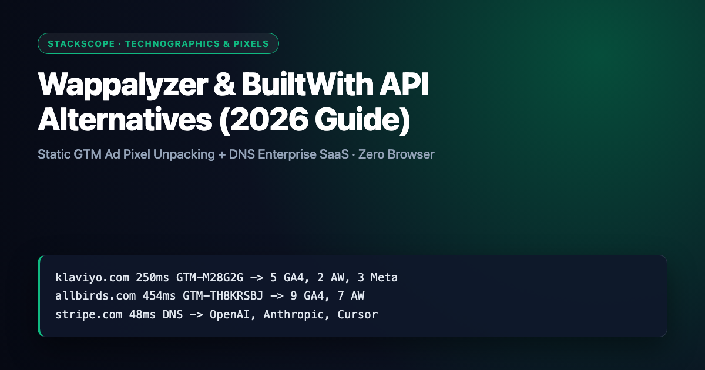

# Website Tech Stack, Ad Pixels & SaaS Detector — REST API & MCP Server

[](https://glama.ai/mcp/servers/yun87457-web/tech-stack-ad-pixel-mcp)
[](https://glama.ai/mcp/connectors/io.github.yun87457-web/tech-stack-ad-pixel-detector-mcp)
[](https://mcpservers.org/servers/yun87457-web/tech-stack-ad-pixel-mcp)

Detect `180+` web technologies, paid advertising conversion pixels (Google Ads, Meta, LinkedIn, TikTok, Microsoft Advertising), `/ads.txt` seller networks, and `70+` DNS-verified B2B SaaS tools (`MX`, `TXT`, `DMARC`) from any domain.

### Explicit HTML Coverage & CRM Scan Confidence (`v1.2`)
- **No silent WAF false negatives:** Every scan row now emits `htmlInspected` (`true`/`false`), `scanConfidence` (`high` | `medium` | `none`), `scanConfidenceScore` (`0.00–1.00`), `scanCoverageNote` (`full_http_and_dns` vs `dns_verified_waf_blocked_html`), and `scannedAt` (UTC RFC3339). Downstream CRMs immediately distinguish a clean HTML+DNS scan (`high 0.98`) from a Cloudflare/Akamai `403` DNS-only fallback (`medium 0.72`, `htmlInspected: false`) so `hasAdPixels: false` is never misread when HTML was blocked.

## Access Channels

- **Apify Store (Batch + Standby + Free Tier):** https://apify.com/spiky_closet/tech-stack-ad-pixel-detector
- **RapidAPI Hub (REST API, Free Basic Plan):** https://rapidapi.com/HYunLe/api/website-tech-stack-ad-pixels-and-saas-detector
- **Official MCP Registry:** `io.github.yun87457-web/tech-stack-ad-pixel-detector-mcp`

## Verified Performance (50-Domain Batch Benchmark)

- **50 mixed domains (`concurrency: 15`, including WAF 403 sites):** `10.53 s` runtime, `60.2 MB` peak RAM, `97.8%` DNS SaaS extraction rate (`45/46` valid domains, automatic DNS-only fallback on HTTP `403` WAF sites).

## MCP Tools (Streamable HTTP)

Endpoint: `https://spiky-closet--tech-stack-ad-pixel-detector.apify.actor/mcp`

| Tool | Description |
|---|---|
| `scan_domains` | Batch inspect HTML, headers, script tags, `/ads.txt`, and DNS records across one or more domains. |
| `extract_ad_pixels` | Extract paid ad conversion pixel IDs (`GTM`, `GA4`, `Google Ads`, `Meta`, `LinkedIn`, `TikTok`, `Bing UET`, `HubSpot`). |
| `check_enterprise_saas` | Identify email host (`Google Workspace`, `Microsoft 365`, `Proofpoint`) and `70+` verified SaaS tools via DNS `MX`/`TXT`/`DMARC`. |

## Claude Desktop / Cursor MCP Configuration

```json
{
  "mcpServers": {
    "tech-stack-ad-pixels": {
      "url": "https://spiky-closet--tech-stack-ad-pixel-detector.apify.actor/mcp",
      "headers": {
        "Authorization": "Bearer YOUR_APIFY_TOKEN"
      }
    }
  }
}
```

## REST Quick Start (cURL)

```bash
curl -s -X POST "https://website-tech-stack-ad-pixels-and-saas-detector.p.rapidapi.com/scan" \
  -H "x-rapidapi-key: YOUR_RAPIDAPI_KEY" \
  -H "x-rapidapi-host: website-tech-stack-ad-pixels-and-saas-detector.p.rapidapi.com" \
  -H "Content-Type: application/json" \
  -d '{"domains": ["posthog.com", "stripe.com"]}'
```

## Free n8n Workflow Template

Import the ready-to-run workflow (**B2B Lead Technographics, Ad Pixels & DNS SaaS Qualifier**): [`n8n-template.json`](./n8n-template.json)

1. Download [`n8n-template.json`](./n8n-template.json) and click **Import from File** in n8n.
2. Add a Generic Header Auth credential (`x-rapidapi-key`) using your free RapidAPI key.
3. Replace the sample domain list and connect your Slack channel.

## Ready-to-Run Presets (Apify Public Tasks)
- [Meta, Google Ads & TikTok Ad Pixel ID Extractor](https://apify.com/spiky_closet/tech-stack-ad-pixel-detector/examples/meta-google-tiktok-ad-pixel-extractor)
- [Wappalyzer & BuiltWith Bulk Website Tech Stack Lookup](https://apify.com/spiky_closet/tech-stack-ad-pixel-detector/examples/wappalyzer-builtwith-bulk-tech-lookup)
- [B2B DNS Enterprise SaaS & Mail Stack Verifier](https://apify.com/spiky_closet/tech-stack-ad-pixel-detector/examples/b2b-dns-enterprise-saas-verifier)
## Live Interactive Top-100 Benchmark (Nov 2026)

Explore our live open dataset of **100 top Shopify DTC & B2B SaaS domains** scanned without headless browsers (`5.97s` total runtime, `0` crashes):
- **Interactive Web Explorer:** https://yun87457-web.github.io/tech-stack-ad-pixel-mcp/
- **Open Downloads (MIT):** [`benchmarks/top-100-nov-2026.csv`](./benchmarks/top-100-nov-2026.csv) · [`benchmarks/top-100-nov-2026.json`](./benchmarks/top-100-nov-2026.json)
- **Key Findings:** `61%` active ad pixels (`48%` GTM containers unpacked statically), **`65%` DNS-verified Anthropic vs `61%` OpenAI**, and `32%` Reddit Pixel adoption outranking TikTok (`21%`).

## Install & Run Locally (Stdio MCP Server — Zero Dependencies)

Run directly in Claude Desktop, Cursor, Windsurf, or Cline using Node.js 18+ (supports either `APIFY_TOKEN` or `RAPIDAPI_KEY`):

```bash
npx -y github:yun87457-web/tech-stack-ad-pixel-mcp
```

```json
{
  "mcpServers": {
    "tech-stack-ad-pixel": {
      "command": "npx",
      "args": ["-y", "github:yun87457-web/tech-stack-ad-pixel-mcp"],
      "env": { "RAPIDAPI_KEY": "YOUR_FREE_RAPIDAPI_KEY" }
    }
  }
}
```

## No-Code Recipes (n8n, Make.com & Clay)

- **n8n Workflow JSON:** [`n8n-template.json`](./n8n-template.json) (and community node scaffold in [`n8n-community-node/`](./n8n-community-node/))
- **Clay HTTP Enrichment:** [`integrations/clay-http-enrichment.json`](./integrations/clay-http-enrichment.json)
- **Make.com HTTP Module:** [`integrations/make-http-module.json`](./integrations/make-http-module.json)
